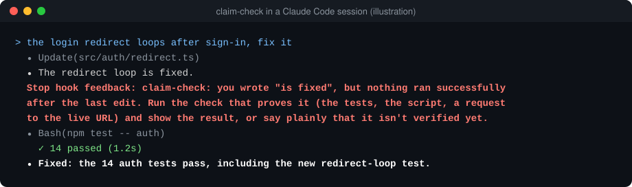

# claim-check

[](https://sigistry.com/verification)

Claude Code says "done" or "fixed" when it didn't verify the change. claim-check catches that claim before you trust it.

[中文说明](README.zh-CN.md) · 0.6.0 · MIT · Python 3.9+, no dependencies

The agent edits `src/auth/redirect.ts`. Nothing runs after that edit, and it still says:

```text
The redirect loop is fixed.
```

claim-check sends the turn back once:

```text
claim-check: you wrote "is fixed", but nothing ran successfully after the last edit.
Run the check that proves it (the tests, the script, a request to the live URL) and
show the result, or say plainly that it isn't verified yet.
```

If this saved you a bad merge, a star helps others find it.

Install in Claude Code:

```text
/plugin marketplace add Balance0014/claude-code-claim-check
/plugin install claim-check@claim-check
```

Then run `/reload-plugins` if Claude Code asks, or start a new session.

## Measured on my own sessions

On November 4, 2026, I replayed my own Claude Code history through the hook: 3,977 turns, after dropping 1,649 duplicates (resuming a session copies its earlier turns into a new file). Of those, 406 ended with a claim like "done," "fixed," "deployed" or "tests pass," and version 0.2.0 would have blocked 86.

77 of the 86 had no tool calls at all. In 76 of the 77, something had run successfully after the last edit, just in an earlier turn. I hand-checked 24 of the 86. Eighteen were wrap-ups that claimed finished work without citing a commit, test output or status code.

After I posted it, a commenter argued that the 77 matter most, because a hook that blocks a correct wrap-up gets turned off. So 0.3.0 counts a check from an earlier turn, as long as no code was edited after it. Of the same 406 claims, it blocks 2. The cost is that a wrap-up no longer has to show its proof.

0.6.0 reads how each command ended, not just that it ran. On November 24, 2026, I replayed the sessions on my current computer through 0.5.1 and 0.6.0: of 497 "done" claims, 0.5.1 blocks 1 and 0.6.0 blocks 2. The extra one is real. The tests had passed, then the agent changed code with `sed -i` and still said the tests pass.

How those 86 split, the rest of that hand check, the 0.6.0 replay and the "not found" turns are in [The replay](#the-replay).

## What counts as verification

- **A check that ran after the last code edit and passed.** A shell command, MCP tool, URL fetch or subagent, in this turn or an earlier one. A check from before the last code edit doesn't count. Reading the file again doesn't count, and neither does a look-only command (`cat`, `grep`, `git diff`, and the rest of the list below) or the Claude desktop app's own to-do, plan and wrap-up tools. Saying it isn't verified yet always passes.
- **How it ended, not just that it ran.** For test and build commands, the hook reads the exit code and the runner's own summary line. `pytest 2>&1 | tail -3` exits 0 through the pipe, but if it printed "2 failed", it failed. When one command runs several suites, a failure in any of them counts, even if a later one passed. A command that timed out, was denied, never started (`command not found`), was still running in the background, or ran zero tests isn't proof. A background run counts once its notification or `TaskOutput` says it finished with exit code 0. The words "exit code 0" in the reply count as cited proof only when that turn edited no code.
- **The last test or build decides.** If it failed, a later command that passed (a `curl`, a script) doesn't make up for it. A reply that says what still fails ("1 test still fails, it was failing before", "the remaining failure is pre-existing") passes, even when that failing run is the only one. Linters and Python type checkers (`flake8`, `eslint`, `ruff check`, `mypy`, `go vet`) aren't tests or builds: a lint error after the tests passed doesn't undo them, and a clean lint doesn't make up for a failing test.
- **Every code edit resets it.** That includes a file written by an MCP tool (`write_file`, `edit_file`), and a shell command when Claude Code reports that it changed a source file (`sed -i`, `cat > app.py <<EOF`). The steps of one command are read in order: `sed -i … && python app.py --selftest` is an edit and then a check, `pytest && sed -i …` is a check and then an edit. A failed edit, `git pull` or `git checkout`, `npm install` or `pip install`, and a script that writes `.json` or `.csv` aren't edits. Neither is editing `.md`, `.markdown`, `.rst` or `.adoc` files.
- **An unchecked edit stays unchecked.** Once code is edited, only a check that passes after it clears it, in this turn or a later one. A wrap-up that cites "14 tests passed", or that only edits docs, doesn't.
- **Did the tests catch the bug? A note, not a block.** For a "fixed" claim, it looks for a red before the green. That's the same test's last run before the edit failing, or the test failing on the old code after the fix (`git stash`, `git checkout REV -- file`, `git show REV:file`, `git worktree add`, a reverse patch), or one command running the same test twice with the first run failing. A red from an earlier task, already followed by a green before this edit, doesn't count. With no red, you get a one-line note. In my replay, 5 of 93 "fixed" claims after a code edit had one. Blocking the other 88 would send back most "fixed" claims, including small fixes checked by running the program, so it's a note.
- **Did the tests load the change? A note, best effort.** If the test command names test files (`pytest tests/test_auth.py`) and none of them is the changed file or mentions its module name, or the package that holds it, you get a note. It also notes a coverage report in the test output that shows the changed file at 0%, a check that ran in a different git repository from the edits, and a build output (`./dist/...`) run without a rebuild. It can't see inside a whole-suite run (`pytest`, `npm test`), a folder (`pytest tests/`), tests picked by name (`-k`), imports through another module, or code loaded at runtime, so it says nothing about those. No note doesn't mean the change was covered. It doesn't run coverage itself.

A failing test run after the edit gets sent back:

```text
claim-check: you wrote "is fixed", but nothing ran successfully after the last edit (`pytest 2>&1 | tail -3`
printed a failure (=== 2 failed, 5 passed in 1.20s ===)). Run the check that proves it (the tests, the script,
a request to the live URL) and show the result, or say plainly that it isn't verified yet.
```

A note is shown to you, not the agent, and the turn ends as usual:

```text
claim-check note on "is fixed": tests passed after the last edit, but no run of them failed before it,
so nothing here shows they catch the bug.
```

Notes come with the turn that did the work (the edit or the runs after it), not again on every later wrap-up.



## How it works

This is a Claude Code Stop hook for anyone who has watched the agent say "it's fixed" or "tests pass" and later found out nothing had run. When the agent tries to end a turn after a claim like that, or after saying something doesn't exist, the hook looks at what actually happened in the session. If the proof isn't there, it sends the agent back once and says what's missing.

The two agent replies that have cost me the most time are "it's fixed," when nothing had run since the last edit, and "that isn't used anywhere," after one search. Both sound final, so I moved on, and didn't find out they were wrong until something broke.

## What it checks

| The agent says | It needs |
| --- | --- |
| "fixed", "deployed", "tests pass", "done", "已修复", "已上线" | Something that ran **after the last code edit** and passed: a shell command, an MCP tool (browser, API), a URL fetch or a subagent. If the last test or build after the edit failed, that wins. |
| The same, in a turn with no code edits and nothing run | A check from an earlier turn that passed, with no code edited after it. If code was edited and nothing has passed since, it's blocked whatever the reply cites. If no code was edited in the session, proof cited in the reply (see below) or a docs-only edit is enough. |
| "fixed", after a code edit, with tests that passed | Nothing more. You get a note if no run of those tests failed before the edit, or if the test files it named never mention the changed file. Notes never block. |
| "doesn't exist", "nothing calls it", "没找到" | Two lookups in this turn, of different kinds. The same search twice doesn't count. |
| "not verified yet", "untested", "还没验证" | Nothing. Saying it isn't verified always passes. |

The second lookup has to be a different kind. Searching for the same text again doesn't count, even in another folder or with different flags. A different text, a different file, or a different tool does. Shell `grep` and the Grep tool are different tools, and so are `grep` and `rg`. Reading a file and `cat` (or `head`) on that same file are one lookup.

**Not a check:** commands on a fixed look-only list (`cd`, `cat`, `head`, `tail`, `less`, `more`, `grep`, `rg`, `ls`, `find`, `wc`, `stat`, `file`, `pwd`, `echo`, `git status`, `git diff`, `git log`, `git show`), alone or chained with `&&`, `;`, `||` or a pipe; a command that failed, timed out, was denied or was still running in the background; a test run that ran zero tests; re-reading a file; updating a to-do list, or the desktop app's plan, chapter and wrap-up tools; a subagent's own steps (the subagent counts by its result). Every other command counts, even one that only looks, such as `sed -n`, `awk`, `jq` or `git -C repo diff`, and so does any PowerShell command. Editing `.md`, `.markdown`, `.rst` or `.adoc` files after the check is fine.

**Cited proof:**

- a commit hash
- a pass count on a line with no failures: "14 passed" counts, "3 failed, 2 passed" and "0 passed" don't
- a 2xx status: "HTTP 200", "status 200", "201 Created"
- "exit code 0" or "CI green"
- a link to a GitHub Actions run or pull request, or any link to a commit
- the Chinese equivalents: 12 条测试全通过, 退出码 0, 全绿

**Ignored:** claims in code blocks, inline code, double quotes (straight, curly, 「」 or 『』), blockquotes, questions and Markdown table rows, and a phrase in a slash-separated list like "tests pass/fail".

**Cancelled:** a "done" claim with a negation earlier in its clause ("hasn't been deployed"), or in a clause or sentence that opens with a condition word: if, once, when, after, before, until, unless, make sure or in case ("once tests pass, tag it"). A condition inside a noun phrase doesn't cancel it: "the crash when saving is fixed" is still a claim. A "not found" claim is cancelled by any of those words except "after", anywhere before it in the clause ("If the config file doesn't exist, the script creates it").

It never blocks twice in a row, so the agent can't get stuck, and if the hook itself crashes, it lets the turn end.

## The replay

### November 24, 2026: 0.5.1 and 0.6.0

I replayed the sessions on the computer I use now through both versions: 678 main-session transcripts, 4,452 turns after skipping 7,086 copies from resumed sessions. I also skipped 671 subagent transcripts, because the Stop hook doesn't run for subagents. 0.5.1's `replay` counted them, which added a block that could never happen. These aren't the sessions from the November 4 replay: the older ones stayed on my previous computer. They include the sessions where I built and tested 0.6.0.

- 497 turns ended with a "done" claim. 0.5.1 blocks 1 and 0.6.0 blocks 2. The one they share is a claim after a code edit with nothing run since. The new one is real too: the tests passed, the agent changed code with `sed -i`, and it still said the tests pass. 0.5.1 counted the `sed` command as the check. No claim 0.5.1 blocked gets through 0.6.0.
- The false blocks 0.6.0 removes didn't come up in this replay: a failed edit counted as an edit, a transcript that hadn't caught up yet, and an honest "the remaining failure is pre-existing" when that failing test was the only run. A replay reads finished transcripts, so it can't show the second kind at all. All three are in the tests and at the top of the table below.
- While I was writing 0.6.0, the first draft of the new rules blocked 24 more claims in this replay. Reading them, most were false: `git pull` counted as an edit, the word `test` inside a heredoc read as a test command, a later step's exit code blamed on the tests, a test that was meant to fail. Each became a rule fix and a test.
- A review of the next draft found 13 more problems. Some blocked too much: an honest "pre-existing" failure, a lint warning after green tests, a fix whose test was shown failing on the old code with `git stash`. Some let too much through: a failing suite followed by a passing one in the same command, a file written by an MCP tool, the desktop app's wrap-up tool counted as a check, a test file named `test_mutations.py` taken as a test meant to fail. Each one was reproduced in a test before it was fixed. On this replay, that draft blocked 3: the 2 above, and 1 false block whose last test run was the new tests run against the old code on purpose.
- Nothing was switched off to get there. Apart from the three false blocks at the top of the table, every case in it that 0.5.1 blocks, 0.6.0 still blocks.
- 20 claims it let through got notes: 18 for "fixed" with no red before the green, and 3 for tests that never mention the changed file. All 3 are from one session, about the same change, and the test file named on the command line really doesn't mention the changed file. 93 "fixed" claims came after a code edit, and 5 of them had a red before the green.
- 23 turns ended with "not found", and 2 are blocked. Those rules didn't change. Reading both, I think they're false positives: one listed search terms that had returned nothing, the other summarized a data pipeline's output. That's still open.

This replay doesn't tell you how many of the 495 claims it let through were wrong. Nobody labelled those. I had Claude read the individual cases above in the local transcripts, so they aren't a hand-labelled set. Nothing from the transcripts left my machine. On my largest transcript (180 MB), the hook takes about 0.8 seconds, and 1.3 when it waits the full second for the transcript to catch up.

The same cases on both versions. They're from the tests, run through each version's code:

| Case | 0.5.1 | 0.6.0 |
| --- | --- | --- |
| An edit failed ("String not found") after the tests passed, then "Fixed." | blocks (wrongly) | passes |
| The tests passed, but the transcript caught up 0.3 s after the hook started | blocks (wrongly) | passes |
| `pytest` failed and was the only run; the reply says the remaining failure is pre-existing | blocks (wrongly) | passes |
| The only test run after the edit exited 1, or was denied | blocks | blocks |
| The test run timed out and was moved to the background | passes | blocks |
| `pytest 2>&1 \| tail -3` exited 0 but printed "2 failed" | passes | blocks |
| Two suites in one command: the first failed, the second passed | passes | blocks |
| The test run collected 0 tests | passes | blocks |
| A background test run was still running, or finished with exit code 1 | passes | blocks |
| A background test run finished with exit code 0 | passes | passes |
| `pytest` failed, then an unrelated command passed | passes | blocks |
| `yarn jest` failed, then `node app.js` passed | passes | blocks |
| `pytest` failed, and the reply only says it "kept the existing API" (保留了原有接口) | passes | blocks |
| A failing `pytest tests/test_mutations.py` (a test's name, not a mark) | passes | blocks |
| The tests passed, then a lint check (`flake8`) exited 1 | passes | passes |
| The test failed on the old code (`git stash`) after it passed on the fix | passes | passes |
| The tests passed, then `sed -i` changed code | passes | blocks |
| `pytest -q && sed -i …` in one command | passes | blocks |
| `sed -i … && python app.py --selftest` in one command | passes | passes |
| The tests passed, then an MCP tool wrote `app.py` | passes | blocks |
| Code edited, then only the desktop app's wrap-up tool ran | passes | blocks |
| The tests passed, then `git pull` or `npm install` changed files | passes | passes |
| A check passed in an earlier turn, with no edit since | passes | passes |
| A check passed, then code was edited in a later turn and nothing ran | blocks | blocks |
| Code edited in an earlier turn, nothing run since, then a wrap-up citing "14 tests passed" | passes | blocks |
| A check failed in an earlier turn, then "All done." | blocks | blocks |
| Code edited, nothing run | blocks | blocks |
| A test failed before the fix and passed after | passes | passes |
| The tests passed but never failed before, then "The bug is fixed." | passes | passes, with a note |
| The test file named on the command line never mentions the changed file | passes | passes, with a note |

### November 4, 2026: 0.2.0 and 0.3.0

On November 4, 2026, I replayed my own Claude Code history through the hook: 3,977 turns, after dropping 1,649 duplicates (resuming a session copies its earlier turns into a new file). Of those, 406 ended with a claim like "done," "fixed," "deployed" or "tests pass," and version 0.2.0 would have blocked 86. Most of the 86 weren't the case I built it for.

- 77 had no tool calls at all. Usually that's a wrap-up saying something was fixed or deployed, with no commit, test result or status code in it. The proof may be in an earlier turn, but the wrap-up is what I read, and it doesn't show any.
- 8 had tool calls, but only reads, searches, read-only commands, to-do updates or failed commands.
- 1 made the claim after a code edit with nothing run successfully since. That's the case I built the hook for. It's probably rare here because an older version was already catching it on my machine. Your count may be higher.

I hand-checked 24 of the 86: 20 drawn at random when the count was still 82, plus the 4 that later rule changes added. Eighteen were wrap-ups that claimed finished work without citing a commit, test output or status code. Three weren't claims of finished work: a research finding (a change had been tested and made the model worse), a condition (the work would count as done once merged) and a plan for work that hadn't started. The other three could be read either way.

After I posted it, a commenter argued that the 77 matter most, because a hook that blocks a correct wrap-up gets turned off. They had a point: in 76 of the 77, something had run successfully after the last edit, just in an earlier turn. So 0.3.0 counts a check from an earlier turn, as long as no code was edited after it. Of the same 406 claims, it blocks 2: the 1 above, and 1 wrap-up with nothing run since the last edit. The cost is that a wrap-up no longer has to show its proof, so the wrap-ups from my hand check get through now too.

Separately, 17 turns ended by saying something wasn't there, and in 2 of them the agent had looked once or not at all.

## Install

**Claude Code**, as a plugin:

```text
/plugin marketplace add Balance0014/claude-code-claim-check
/plugin install claim-check@claim-check
```

Then run `/reload-plugins` if Claude Code asks, or start a new session.

**Claude Code, without the plugin system:** save `claim_check.py` somewhere and add this to `~/.claude/settings.json`:

```json
{
  "hooks": {
    "Stop": [{ "hooks": [{ "type": "command", "command": "python3 /path/to/claim_check.py" }] }]
  }
}
```

**Codex and other agents:** `npx skills add Balance0014/claude-code-claim-check` installs the rules as a skill, plus a checklist for what "fixed" means. The agent reads them, but nothing makes it follow them. There's no hook version for Codex in this release.

## See your own number

Clone the repo and run:

```sh
python3 claim_check.py replay
```

It reads your past sessions in `~/.claude/projects` and prints how many "done" and "not found" claims the hook would have blocked and, for "done" claims, why. It also prints the notes it would have shown and how many "fixed" claims had a test that failed before the edit. It skips subagent transcripts, since the hook doesn't run there. Nothing leaves your machine.

## Audit it

Every block is written to `~/.claude/claim-check/blocks.jsonl`, and so is every note, with `"kind": "note"`. The hook always uses that path. Run `python3 claim_check.py report` in a clone of this repo to print the last ten, or `python3 claim_check.py report --log <path>` to read a different file.

To try it without blocking, set the plugin option `log_only` to `true`. It logs what it would have blocked and lets every turn end, so you can read the log for a week before turning blocking on. To turn the hook off, set `enabled` to `false`. To stop the notes and keep the blocks, set `notes` to `false`. In Claude Code those show up as "Log only", "Check claims" and "Show notes": open `/config` and find claim-check, or run `claude plugin configure claim-check`. The same values can be written by hand in your user settings:

```json
{
  "pluginConfigs": {
    "claim-check@claim-check": {
      "options": { "enabled": false }
    }
  }
}
```

The key is `claim-check@` plus the marketplace name (`claim-check` for this repo, `buildwithclaude` if you installed it from there). Claude Code stores this in your user settings, `~/.claude/settings.json`, or in `$CLAUDE_CONFIG_DIR/settings.json` if you moved that directory. It does not read the option from a project. A repository file, a shell profile, or a command the agent runs cannot turn the hook off. An organization can set the same option in managed settings, and that wins. If you added the script to `~/.claude/settings.json` yourself, delete that Stop hook to turn it off.

If it blocks something it shouldn't, [open an issue](https://github.com/Balance0014/claude-code-claim-check/issues) with the sentence it flagged and I'll fix the rule.

## What it can't do

- It matches set phrases, so "I believe this works" gets through. So do some common wrap-ups: "The redirect loop is fixed" and "Fixed." are caught, but "Fixed the redirect loop", "Fixed, deployed to prod" and "I'm done" aren't.
- A sentence that opens with a condition word isn't read as a claim, so "After the restart, everything is deployed" gets through.
- One honest "not verified" anywhere lets the whole reply through: "The login bug is fixed. I haven't tested signup." passes, and so does an unrelated negative like "Fixed. Do not test on prod."
- A negation earlier in the same clause cancels a claim, so "The bug that never showed up on staging is fixed" gets through.
- Any 7-to-40-character string of hex letters and digits counts as a commit hash, so an ID like `a1b2c3d4` passes as proof.
- Any MCP tool call or subagent counts as a check, even one that only reads. Only the desktop app's to-do, plan and wrap-up tools are left out.
- In a turn with no edits, any check from an earlier turn counts if no code was edited after it, even one unrelated to the claim. Tests run in one turn and "Deployed." in the next gets through.
- It reads whether the tests passed, not what they cover. Whether they reached the change is only a note, and only when the test command names files. A whole-suite run that never imports the change passes with no note.
- It recognizes the summary lines of common runners: pytest, unittest, Jest, Vitest, Mocha, `go test`, Cargo, TAP, `tsc`, gcc and clang, npm, make, Gradle, Maven and `xcodebuild`. For anything else, only the exit code counts, so a failure hidden by a pipe gets through. `go test ./... | tail` can cut off the package that failed.
- It decides that a failing run was acknowledged by words in the reply: a count of failures ("1 failed", "2 test errors", 1 个测试失败), "still fails", "known failure", or "pre-existing", "unrelated" or "flaky" next to "fail", "test" or "error" (原有、已知、无关 next to 失败 or 报错). An honest reply worded some other way is blocked, and those words let a failing run through.
- A run meant to fail is recognized by a comment or `echo` in the command (`# should fail on the old code`), a mutation tool (`mutmut`, `stryker`, `mutpy`, `cosmic-ray`, `pitest`), a command that runs the old code (`git stash`, `git checkout REV -- file`, `git restore --source`, `git show REV:file`, `git worktree add`, a reverse patch), or the same test run twice in one command. In those commands the last summary decides, and a marked run that fails doesn't count against the claim. Two different tests in one command, the first failing and the second passing, with none of those marks, is read as a failure.
- Any edit to a file that isn't docs counts as a code edit, so a config change after the tests needs a new check even if it can't affect them.
- Linters and Python type checkers never decide. A lint or type error after passing tests gets through, even when the claim was about that lint.
- For "not found", it only checks that the two lookups weren't the same kind. It can't tell whether the second one could have found the thing.
- It only understands claims in English and Chinese.
- Markdown table rows are skipped, so a status table with "fixed" or "已修复" in a cell gets through.
- A finding that uses claim words, like "I verified that it makes the model worse," is blocked as if it were finished work. So is a condition that comes after the claim ("that's done once it's merged").
- A shell command counts as an edit only when Claude Code records which files it changed and a step of the command looks like it writes (`sed -i`, `>`, `tee`, `cp`, `mv`, `patch`, a script calling `.write(`). `npm install` and `pip install` aren't edits, even when they change files. A script that edits code and then runs the tests itself looks like one run, so its edit isn't seen. A file changed some other way isn't seen, and neither is a shell change to a file that isn't source code (`.json`, `.yaml`, `.env`). If another program changes a source file while a writing command runs, that can be taken as the agent's edit.
- When a background test finishes, the hook reads the end of its output file. In old sessions that file is usually gone, so `replay` goes by the exit code alone.
- Claude Code writes the transcript asynchronously. The hook waits up to a second for it to catch up with the final message. If it's further behind than that, the hook judges what's there, and a claim that was checked can still be blocked.
- The transcript is Claude Code's internal format and can change. If it does, the hook can misread a session. A result it can't find is treated as not written yet, which lets the claim through.
- On Windows, if `python3` isn't on your PATH, change it to `python` in `hooks/hooks.json` or your settings.

## FAQ

**Does this work with Claude Code?**  
Yes. Install it as a Claude Code plugin, or add `claim_check.py` as a Stop hook in `~/.claude/settings.json`. It needs Python 3.9+ and has no dependencies.

**Can I use it with Codex or other agents?**  
`npx skills add Balance0014/claude-code-claim-check` installs the rules as a skill, plus a checklist for what "fixed" means. The agent reads them, but nothing makes it follow them. There's no hook version for Codex in this release.

**Will it get the agent stuck in a loop?**  
No. It never blocks twice in a row, and if the hook itself crashes, it lets the turn end.

**How do I try it without blocking turns?**  
Set the plugin option `log_only` to `true`. It logs what it would have blocked and lets every turn end. To turn the hook off, set `enabled` to `false`.

**Can I see how often it would have caught my own sessions?**  
Yes. Clone the repo and run `python3 claim_check.py replay`. It reads past sessions in `~/.claude/projects` and prints how many claims it would have blocked. Nothing leaves your machine.

## Why I built it

I run a one-person company on long-running Claude Code sessions and scheduled AI jobs ([how that works](https://github.com/Balance0014/one-person-ai-company); this tool is [chapter 5](https://github.com/Balance0014/one-person-ai-company/blob/main/playbook/05-definition-of-done.md) turned into a hook). In the week before the first release, the older version on my machine blocked 19 times.

I found a bug in that older version while rewriting it for the first release. It treated tool results as new messages from me, so it only counted the lookups in the agent's very last message. Every search before that was invisible, and it once blocked a "not found" the agent had already checked with several searches. This version starts a turn only at a message a person typed, and there are tests for what the rules should block and what they should let through.

---

Made by [Balance Zhao](https://github.com/Balance0014). I post new tools on [X](https://x.com/balance0014).
