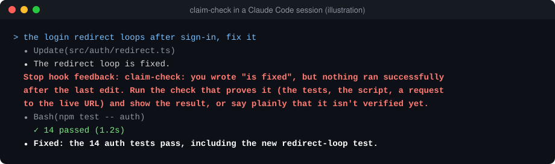

# claim-check

**A Claude Code Stop hook that won't let your coding agent say "fixed" until it shows the proof.**

[中文说明](README.zh-CN.md) · MIT · Python 3.9+, no dependencies



The two agent replies that have cost me the most time are "it's fixed," when nothing had run since the last edit, and "that isn't used anywhere," after one search. Both sound final, so I moved on, and didn't find out they were wrong until something broke.

On November 4, 2026, I ran the hook over my own Claude Code history. That came to 3,977 turns, after dropping 1,649 duplicates (resuming a session copies its earlier turns into a new file). Of those, 404 ended with a claim like "done," "fixed," "deployed" or "tests pass," and the hook would have blocked 82. Most of the 82 weren't the case I built it for.

- 76 had no tool calls at all. Usually that's a wrap-up saying something was fixed or deployed, with no commit, test result or status code in it. The proof may be in an earlier turn, but the wrap-up is what I read, and it doesn't show any.
- 5 had tool calls, but only reads, searches, to-do updates or commands that failed.
- 1 made the claim after a code edit with nothing run since. That's the case I built the hook for. It's probably rare here because an older version of the hook has been running on my machine since May, so your own count may well be higher.

I read a random 20 of the 82. Sixteen were wrap-ups that claimed finished work and cited nothing. Two weren't claims of finished work: a research finding ("I verified that it makes the model worse") and a condition ("once it's merged, that's done"). The other two could be read either way.

Separately, 18 turns ended by saying something wasn't there, and 2 of those had looked once or not at all.

When the agent tries to end its turn, the hook compares what it claimed with what it actually ran since your last message. If the proof isn't there, it sends the agent back once and says what's missing.

```text
claim-check: you wrote "is fixed", but nothing ran after the last edit. Run the check
that proves it (tests, the command, a request to the live URL) and show the result,
or say plainly that it is not verified yet.
```

## What it checks

| The agent says | It needs, in this turn |
| --- | --- |
| "fixed", "deployed", "tests pass", "done", "已修复", "已上线" | Something that ran **after the last code edit** and didn't fail: a shell command, a browser or API tool, a URL fetch, or a subagent. Commands that only look (`cat`, `grep`, `ls`, `git diff` and the like), re-reading a file and updating a to-do list don't count. Editing notes or docs after the check is fine. |
| The same, in a turn with no code edits and nothing run | Proof cited in the reply: a commit hash, a test count, a status code, a CI link. A turn that only edits docs passes. |
| "doesn't exist", "nothing calls it", "没找到" | At least two reads, searches or commands. |
| "not verified yet", "untested", "还没验证" | Nothing. An honest answer always passes. |

Claims inside code blocks, quotes, questions and Markdown table rows are ignored, and so is a word in a slash-separated list of labels like "open/resolved/closed". It never blocks twice in a row, so the agent can't get stuck, and if the hook itself crashes, it lets the turn end.

## Install

**Claude Code**, as a plugin:

```text
/plugin marketplace add Balance0014/claude-code-claim-check
/plugin install claim-check@claim-check
```

Then start a new session.

**Claude Code, without the plugin system:** save `claim_check.py` somewhere and add this to `~/.claude/settings.json`:

```json
{
  "hooks": {
    "Stop": [{ "hooks": [{ "type": "command", "command": "python3 /path/to/claim_check.py" }] }]
  }
}
```

**Codex and other agents:** `npx skills add Balance0014/claude-code-claim-check` installs the same rules as a skill. The agent reads them, but nothing makes it follow them. Codex has its own hook system, and an adapter for it isn't in this release.

## See your own number

Clone the repo and run:

```sh
python3 claim_check.py replay
```

It reads your past sessions in `~/.claude/projects` and prints how many "done" and "not found" claims the hook would have blocked, with the reasons. Nothing leaves your machine.

## Audit it

Every block is written to `~/.claude/claim-check/blocks.jsonl`, and `python3 claim_check.py report` prints the last ten. If it blocked something it shouldn't have, [open an issue](https://github.com/Balance0014/claude-code-claim-check/issues) with the sentence it flagged. I treat every false positive as a bug.

## What it can't do

- It matches phrases, so "I believe this works" gets through.
- A command after the edit proves that something ran. It doesn't prove the command tested the right thing.
- It only understands claims in English and Chinese.
- Markdown table rows are skipped, so a status table with "fixed" or "已修复" in a cell gets through.
- A finding that uses claim words, like "I verified that it makes the model worse," is blocked as if it were finished work. So is a condition set off by a comma: "once it's merged, that's done."
- It tracks edits made with Claude Code's edit tools. A file changed by a shell command such as `sed -i` isn't seen as an edit.
- On Windows, if `python3` isn't on your PATH, change it to `python` in `hooks/hooks.json` or your settings.
- It's only enforced in Claude Code. Elsewhere it's a skill the agent can choose to follow.

## Why I built it

I run a one-person company on 18 Claude Code sessions and about 20 scheduled AI jobs ([how that works](https://github.com/Balance0014/one-person-ai-company); this tool is [chapter 5](https://github.com/Balance0014/one-person-ai-company/blob/main/playbook/05-definition-of-done.md) turned into a hook). In the week before the first release, the older version on my machine blocked 19 times.

I found a bug in that older version while rewriting it for the first release. It treated tool results as new messages from me, so it only counted the lookups in the agent's very last message. Every search before that was invisible, and it once blocked a "not found" the agent had already checked with several searches. The new one starts a new turn only at messages a person actually types, and there are tests for what the rules should block and what they should let through.

---

Made by [Balance Zhao](https://github.com/Balance0014). I post new tools on [X](https://x.com/balance0014).
