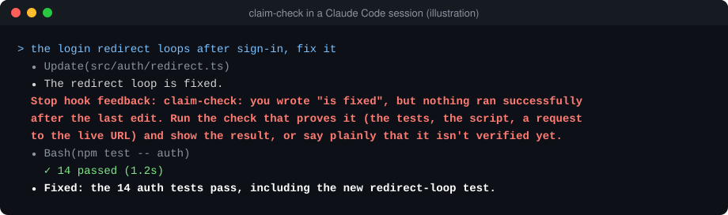

# claim-check

**一个 Claude Code 的 Stop 钩子：AI 说「修好了」却拿不出证据，就把它打回去。**

[English](README.md) · MIT · Python 3.9+，不用装任何依赖



用 AI 写代码，最坑人的是两句话：一句是「修好了」，其实改完之后什么都没跑；另一句是「这个没地方在用」，其实只搜了一次。两句听着都像板上钉钉，我就接着往下做，直到出了问题才发现不对。

2026 年 11 月 4 日，我用这个钩子回放了自己的 Claude Code 历史记录：去掉 1,649 份重复副本后，共 3,977 轮（恢复会话时，之前的几轮会被原样复制进新文件）。其中 405 轮以「做完了 / 修好了 / 上线了 / 测试通过」这类话收尾，按钩子的规则，有 85 轮会被拦下。这 85 轮大多不是我原来担心的那种。

- 76 轮一个工具都没调用，多半是收尾汇报：说某件事修好了、上线了，却没给 commit 哈希、测试结果或状态码。证据可能在前面几轮，但我平时只看汇报，而汇报里看不到。
- 8 轮调了工具，但只是读文件、搜索、跑只看不改的命令、更新待办，或者命令报错了。
- 1 轮是改完代码之后没有成功跑过任何东西，就说做完了。这才是我做这个钩子要防的情况。它这么少，多半是因为旧版早就在我电脑上拦着了，你自己跑出来可能更多。

这 85 轮里我逐条人工核对了 23 轮：规则改动前（那时是 82 轮）随机抽了 20 轮，再加上改动后新增的 3 轮。17 轮正是声称已完工、却没给 commit 哈希、测试输出或状态码的收尾汇报；3 轮其实不算完工汇报，分别是一条调研结论（某个改动验证过，会让模型变差）、一个条件句（合并之后才算做完）和一份还没动手的计划；另外 3 轮两可。

另外，有 17 轮以「没找到」这类话收尾，其中 2 轮只查了一次，或者一次都没查。

每当 AI 想结束这一轮，钩子就拿它嘴上说的，跟你上一句话之后它实际做过的事对一遍。缺证据，就打回去一次，告诉它缺什么：

```text
claim-check: you wrote "is fixed", but nothing ran successfully after the last edit.
Run the check that proves it (the tests, the script, a request to the live URL) and
show the result, or say plainly that it isn't verified yet.
```

## 怎么判

| AI 说 | 这一轮里必须有 |
| --- | --- |
| 「已修复」「已上线」「测试通过」「fixed」「deployed」「done」 | **最后一次改代码之后**真跑过点东西，而且没报错：一条命令、任意 MCP 工具（浏览器、接口）、一次网页请求，或者一个子代理 |
| 同样的话，但这一轮没改代码，也没真跑过东西 | 回复里带证据（见下文）。这一轮只改了文档的，直接放行。 |
| 「没找到」「没人调用」「doesn't exist」 | 至少读过、搜过或跑过两次。 |
| 「还没验证」「未测试」「not verified yet」 | 什么都不用。说明还没验，一律放行。 |

**不算验证的**：一份固定名单上只查看、不修改的命令（`cd`、`cat`、`head`、`tail`、`less`、`more`、`grep`、`rg`、`ls`、`find`、`wc`、`stat`、`file`、`pwd`、`echo`、`git status`、`git diff`、`git log`、`git show`），单独跑或者用 `&&`、`;`、`||`、管道串起来都一样；跑失败的命令；回头再读一遍文件；更新待办清单。名单以外的命令都算，哪怕它也只是查看，比如 `sed -n`、`awk`、`jq`、`git -C repo diff`；PowerShell 命令也一律算。验完之后改 `.md`、`.markdown`、`.rst`、`.adoc` 文件没关系。

**回复里带的证据**，指的是：

- commit 哈希
- 同一行里没有失败数的通过数：「14 passed」「12 条测试全通过」算，「3 failed, 2 passed」「0 passed」不算
- 2xx 状态：「HTTP 200」「status 200」「201 Created」
- 「exit code 0」「退出码 0」「CI green」「全绿」
- GitHub Actions 运行、commit 或 PR 的链接

**不检查的**：代码块、行内代码、双引号（直引号、弯引号、「」『』）、引用块、问句和 Markdown 表格行里的话，以及「测试通过/失败」这种用斜杠隔开的标签。

**不算数的**：「做完了」这类说法，同一个分句里前面有否定词（「没有」「还没」「尚未」「并未」「未能」，英文的 not、no、never、nothing、n't），或者分句、整句以条件词开头（「如果」「一旦」「等到」「假如」「要是」，英文的 if、once、when、until、unless、before、after），都不算，比如「还没部署」「一旦测试通过，就打标签」。条件词夹在名词短语里不算数：「保存时崩溃的问题已经修好了」照样算说法。「没找到」这类说法，同一个分句里前面任何位置有条件词都不算，条件词还包括「万一」「确保」（「如果没找到配置文件，脚本会自动创建」）。

它不会连着拦两次，所以 AI 不会被卡死；钩子自己出错时，一律放行。

## 安装

**Claude Code 插件**：

```text
/plugin marketplace add Balance0014/claude-code-claim-check
/plugin install claim-check@claim-check
```

装完如果 Claude Code 提示，就运行 `/reload-plugins`，或者开一个新会话。

**不用插件**：把 `claim_check.py` 放到任意位置，在 `~/.claude/settings.json` 里加上：

```json
{
  "hooks": {
    "Stop": [{ "hooks": [{ "type": "command", "command": "python3 /path/to/claim_check.py" }] }]
  }
}
```

**Codex 和其他 agent**：`npx skills add Balance0014/claude-code-claim-check` 装的是技能版，规则相同，外加一份「修好了」要满足哪几条的清单。AI 会读，但没有任何机制强制它照做。这一版没有给 Codex 做钩子。

## 看看你自己的数字

克隆仓库后运行：

```sh
python3 claim_check.py replay
```

它读 `~/.claude/projects` 里的历史会话，算出你的 AI 说「做完了」「没找到」时，有多少次会被这个钩子拦下；「做完了」这一类还会按原因分开列。数据不出你的电脑。

## 查它有没有拦错

每次拦截都记在 `~/.claude/claim-check/blocks.jsonl`（设 `CLAIM_CHECK_LOG` 可以换位置）。在克隆下来的仓库里运行 `python3 claim_check.py report`，会列出最近十条。要关掉钩子，把 `CLAIM_CHECK_OFF` 设成任意非空值（`0` 也行），设在启动 Claude Code 的终端里，或者写进 `settings.json` 的 `env`。拦错了请[提 issue](https://github.com/Balance0014/claude-code-claim-check/issues)，附上被拦的那句话，我来改规则。

## 它做不到的

- 它只匹配固定说法，AI 写「我认为应该可以了」就拦不住。
- 回复里只要有一处老实说没验，整段都放行：「登录的 bug 修好了。注册还没测。」能过。跟验证无关的否定句也会让它放行，比如「Fixed. Do not test on prod.」，里面的 not test 被当成了「没测」。
- 同一个分句里前面出现否定词，后面的说法就不算了，所以「没有复现过的那个 bug 已经修好了」也能过。
- 7 到 40 位、字母数字混排的十六进制串都会被当成 commit 哈希，所以 `a1b2c3d4` 这样的 ID 也算证据。
- 任何 MCP 工具调用或子代理都算验证，哪怕它只是读东西。
- 改完之后跑过命令，只能证明跑了东西，证明不了测对了地方。
- 只认得中文和英文的说法。
- Markdown 表格行不检查，所以状态表里写着「已修复」也能过。
- 调研结论里如果用了「已验证」这类词（比如「已验证会让模型变差」），也会被当成「做完了」拦下。条件放在后面的也会被误拦，比如「合并后就算做完了」里的「合并后」，它认不出是条件。
- 它只认 Claude Code 自带的改文件工具。用 `sed -i` 这类命令改的文件，它看不出是改动，而且这条 `sed` 命令本身还会被当成验证。
- Claude Code 是异步写会话记录的；钩子运行时如果最后那条命令还没写进去，已经验过的说法也可能被拦。
- Windows 上如果没有 `python3` 命令，把 `hooks/hooks.json` 或设置里的 `python3` 改成 `python`。

## 为什么做这个

我一个人经营一家公司，靠一批长期运行的 Claude Code 会话和定时 AI 任务（[具体怎么管](https://github.com/Balance0014/one-person-ai-company/blob/main/README.zh-CN.md)；这个工具就是把其中[第 5 章](https://github.com/Balance0014/one-person-ai-company/blob/main/playbook/zh-CN/05-definition-of-done.md)做成了钩子）。第一版发布前那一周，我电脑上的旧版拦了 19 次。

为第一版重写时，我发现旧版有个 bug：它把工具返回的结果也当成了我新说的话，所以只数 AI 最后一条消息里的查找，前面查过的全都看不见。有一次 AI 明明已经搜过好几遍才说「没找到」，还是被它拦了。新版只把人亲手发的消息当作新一轮的开头，测试里既有该拦住的例子，也有该放行的例子。

---

作者 [Balance Zhao](https://github.com/Balance0014)。新工具会发在 [X](https://x.com/balance0014) 上。
