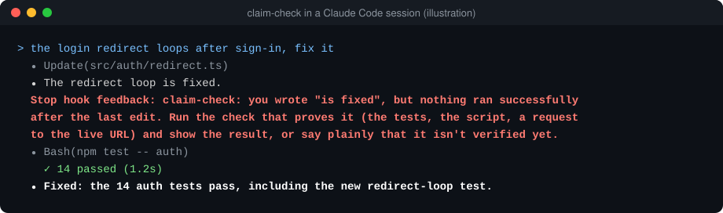

# claim-check

[](https://sigistry.com/verification)

Claude Code 会说「做完了」或「修好了」，其实这一改它并没有验证。claim-check 在你相信这句话之前，把没验证的说法拦下来。

[English](README.md) · 0.6.0 · MIT · Python 3.9+，不用装任何依赖

它改了 `src/auth/redirect.ts`。改完之后什么都没跑，还是说：

```text
The redirect loop is fixed.
```

钩子把这一轮打回去一次：

```text
claim-check: you wrote "is fixed", but nothing ran successfully after the last edit.
Run the check that proves it (the tests, the script, a request to the live URL) and
show the result, or say plainly that it isn't verified yet.
```

如果它帮你躲开过一次不该合的改动，一个 star 能让别人也找到它。

在 Claude Code 里安装：

```text
/plugin marketplace add Balance0014/claude-code-claim-check
/plugin install claim-check@claim-check
```

装完如果 Claude Code 提示，就运行 `/reload-plugins`，或者开一个新会话。

## 我自己会话里量到的

2026 年 11 月 4 日，我用这个钩子回放了自己的 Claude Code 历史记录：去掉 1,649 份重复副本后，共 3,977 轮（恢复会话时，之前的几轮会被原样复制进新文件）。其中 406 轮以「做完了 / 修好了 / 上线了 / 测试通过」这类话收尾，按 0.2.0 版的规则，有 86 轮会被拦下。

这 86 轮里有 77 轮一个工具都没调用。其中 76 轮，最后一次改代码之后其实成功跑过东西，只是在前面几轮。这 86 轮里我逐条核对了 24 轮，18 轮是声称已完工、却没给 commit 哈希、测试输出或状态码的收尾汇报。

发出来以后，有位网友说最该看的是那 77 轮：收尾汇报本身没错却被拦，用的人很快就会把钩子关掉。所以 0.3.0 把前面几轮跑过的检查也算上，只要那之后没再改代码。同样这 406 轮，现在只拦 2 轮。代价是收尾汇报不用再亮出证据。

0.6.0 开始看每条命令最后是什么结果，而不只是跑没跑。2026 年 11 月 17 日，我拿现在这台电脑上的会话，分别用 0.5.1 和 0.6.0 回放：458 句「做完了」里，0.5.1 拦 1 句，0.6.0 拦 2 句。多出来的那句是真问题：测试跑过之后，AI 又用 `sed -i` 改了代码，还说测试都通过。

这 86 轮怎么拆开、那 24 轮里剩下的核对结果、0.6.0 的回放，以及「没找到」的那些轮，写在[回放](#回放)里。

## 什么算验证

- **最后一次改代码之后跑过、而且通过了的检查。** 命令、MCP 工具、网页请求或子代理都行，这一轮或前面几轮都行。最后一次改代码之前跑的不算。再读一遍文件不算，只查看的命令也不算（`cat`、`grep`、`git diff`，以及下面那份名单）。老实说「还没验证」，一律放行。
- **看结果，不只看跑没跑。** 测试和构建命令，钩子会读退出码和测试框架自己打印的汇总行。`pytest 2>&1 | tail -3` 经过管道退出码是 0，但只要打印了「2 failed」，就是失败。超时、被拒、根本没跑起来（`command not found`）、还在后台跑、一个测试都没跑到的，都不算证据。后台跑的命令，等通知或 `TaskOutput` 显示它以退出码 0 跑完才算。回复里写着「exit code 0」，只在这一轮没改代码时算作引用的证据。
- **以最后一次测试或构建为准。** 它失败了，后面再跑通一条别的命令（`curl`、一个脚本）也补不回来。回复里说清还有什么没过（「还有 1 个测试失败，改之前就是红的」），放行。
- **每次改代码都要重新验。** 用命令改的也算，只要 Claude Code 记录显示这条命令改了源代码文件（`sed -i`、`cat > app.py <<EOF`）。改失败了的编辑、`git pull`、`git checkout`，以及写 `.json`、`.csv` 的脚本，不算改动。改 `.md`、`.markdown`、`.rst`、`.adoc` 文件也不算。
- **测试抓得住这个 bug 吗？只提示，不拦。** 说「修好了」时，它找同一个测试在最后一次改动之前失败过、之后通过。找不到失败的那一次，就给你一行提示。我的回放里，改过代码后说「修好了」的 85 句只有 6 句有。另外 79 句全拦，就等于把大部分「修好了」都打回去，包括那些靠直接运行程序验过的小修，所以只提示。
- **测试加载了这次改动吗？只提示，尽力而为。** 测试命令点名了文件（`pytest tests/test_auth.py`），而这些文件既不是被改的文件、也不是装着它的目录、内容里也没提到它的模块名，就给一行提示。测试输出里的覆盖率报告显示被改的文件是 0%、检查跑在和改动不同的 git 仓库里、跑了构建产物（`./dist/...`）却没重新构建，也会提示。整套测试（`pytest`、`npm test`）、按名字挑的测试（`-k`）、经过别的模块间接导入、运行时才加载的代码，它都看不进去，所以不出声。没提示不等于改动被测到了。它自己不跑覆盖率。

改完之后测试失败，会被打回去：

```text
claim-check: you wrote "is fixed", but nothing ran successfully after the last edit (`pytest 2>&1 | tail -3`
printed a failure (=== 2 failed, 5 passed in 1.20s ===)). Run the check that proves it (the tests, the script,
a request to the live URL) and show the result, or say plainly that it isn't verified yet.
```

提示是给你看的，不发给 AI，这一轮照常结束：

```text
claim-check note on "is fixed": tests passed after the last edit, but no run of them failed before it,
so nothing here shows they catch the bug.
```

提示只跟着干活的那一轮（改代码，或改完后跑检查的那一轮）出现，后面每次收尾汇报不再重复。



## 它怎么工作

用 AI 写代码，最坑人的是两句话：一句是「修好了」，其实改完之后什么都没跑；另一句是「这个函数没人调用」，其实只搜了一次。两句听着都像板上钉钉，我就接着往下做，直到出了问题才发现不对。

每当 AI 想结束这一轮，钩子就拿它嘴上说的，跟它实际做过的事对一遍。缺证据，就打回去一次，告诉它缺什么。

## 怎么判

| AI 说 | 必须有 |
| --- | --- |
| 「已修复」「已上线」「测试通过」「fixed」「deployed」「done」 | **最后一次改代码之后**真跑过点东西，而且通过了：一条命令、任意 MCP 工具（浏览器、接口）、一次网页请求，或者一个子代理。改完之后最后一次测试或构建失败了，以它为准。 |
| 同样的话，但这一轮没改代码，也没真跑过东西 | 前面几轮跑过、而且通过了的检查也算，只要那之后没再改代码；否则回复里要带证据（见下文）。这一轮只改了文档的，直接放行。 |
| 改过代码后说「修好了」，测试也通过了 | 不再要别的。如果这些测试在改动之前一次都没失败过，或者点名的测试文件根本没提到被改的文件，会给你一行提示。提示从不拦。 |
| 「没找到」「没人调用」「doesn't exist」 | 这一轮里查过两次，而且两次不是同一种查法。同一种再来一遍不算。 |
| 「还没验证」「未测试」「not verified yet」 | 什么都不用。说明还没验，一律放行。 |

第二次必须换一种查法。同一个词再搜一遍不算，换个目录、改几个参数也不算。换一个词、换一个文件，或者换一个工具，才算。终端里的 `grep` 和 Grep 工具算两种，`grep` 和 `rg` 也算。读一个文件，和用 `cat`（或 `head`）看同一个文件，算同一次。

**不算验证的**：一份固定名单上只查看、不修改的命令（`cd`、`cat`、`head`、`tail`、`less`、`more`、`grep`、`rg`、`ls`、`find`、`wc`、`stat`、`file`、`pwd`、`echo`、`git status`、`git diff`、`git log`、`git show`），单独跑或者用 `&&`、`;`、`||`、管道串起来都一样；跑失败、超时、被拒或者还在后台跑的命令；一个测试都没跑到的测试命令；回头再读一遍文件；更新待办清单。名单以外的命令都算，哪怕它也只是查看，比如 `sed -n`、`awk`、`jq`、`git -C repo diff`；PowerShell 命令也一律算。验完之后改 `.md`、`.markdown`、`.rst`、`.adoc` 文件没关系。

**回复里带的证据**，指的是：

- commit 哈希
- 通过数，且同一行没有失败数：「14 passed」「12 条测试全通过」算，「3 failed, 2 passed」「0 passed」不算
- 2xx 状态：「HTTP 200」「status 200」「201 Created」
- 「exit code 0」「退出码 0」「CI green」「全绿」
- GitHub Actions 运行或 PR 的链接，或者任意 commit 链接

**不检查的**：代码块、行内代码、引用块、问句、Markdown 表格行，以及引号里的话（"…"“…”「…」『…』，单引号除外），还有「测试通过/失败」这种用斜杠隔开的标签。

**不算数的**：「做完了」这类说法有两种情况不算：一是同一分句里前面有否定词（「没有」「还没」「尚未」「并未」「未能」，英文的 not、no、never、nothing、n't），比如「测试还没全部通过」；二是所在分句或整句以条件词开头（「如果」「一旦」「等到」「假如」「要是」「万一」「确保」，英文的 if、once、when、after、before、until、unless、make sure、in case），比如「一旦测试通过，就打标签」。条件词如果只是修饰名词，不影响判断：「用户如果没登录就会崩溃的问题已经修好了」照样会被拦。「没找到」这类说法，只要同一分句里前面出现条件词（after 除外）就不算（「如果没找到配置文件，脚本会自动创建」）。

它不会连着拦两次，所以 AI 不会被卡死；钩子自己出错时，一律放行。

## 回放

### 2026 年 11 月 17 日：0.5.1 对比 0.6.0

我拿现在这台电脑上的会话，分别用两个版本回放：676 个主会话记录，跳过 7,073 份恢复会话产生的副本后共 4,197 轮。575 个子代理的记录也跳过了，因为 Stop 钩子不在子代理上运行；0.5.1 的 `replay` 把它们算了进去，多出一次实际上不可能发生的拦截。这批会话和 11 月 4 日那次不是同一批：更早的会话留在了我之前那台电脑上。

- 458 轮以「做完了」收尾。0.5.1 拦 1 轮，0.6.0 拦 2 轮。两版都拦的那一轮，是改完代码什么都没跑就说做完了。新拦的那一轮也是真问题：测试通过之后，AI 用 `sed -i` 改了代码，还说测试都通过。0.5.1 把那条 `sed` 命令当成了验证。0.5.1 拦下的，0.6.0 一条都没放过去。
- 0.6.0 去掉的误拦有两种：改失败的编辑被当成改动，以及会话记录还没写完。这次回放里两种都没碰上；回放读的是写完的记录，第二种本来就测不出来。两种都写进了测试，也列在下面的表里。
- 写 0.6.0 的过程中，新规则的第一版在这次回放里多拦了 24 轮。逐条看下来，大多是拦错了：`git pull` 被当成改代码、heredoc 里的 `test` 这个词被当成测试命令、后面一步的退出码被算到测试头上、故意让它失败的测试。每一种都改了规则、补了测试，最后只剩上面那条 `sed -i`。没有靠关掉检查来减少误拦：表里 0.5.1 拦的情况，0.6.0 照样拦。
- 放行的说法里有 17 句带了提示：15 句是说「修好了」、但改动之前没有失败过的测试；3 句是测试没提到被改的文件。这 3 句出自同一个会话、同一处改动，命令里点名的那个测试文件确实没提到两个被改的文件。改过代码后说「修好了」的有 85 句，其中 6 句有测试在改动前失败、改动后通过。
- 23 轮以「没找到」收尾，拦了 2 轮，这部分规则没改。两条我都看了，我认为是拦错了：一条是在列出哪些搜索词什么都没搜到，另一条是在汇总一个数据流程的输出。这个问题还没解决。

这次回放说明不了放行的 456 句里有多少其实是错的，这些没人标注过。上面对单条记录的判断，是我让 Claude 在本地读会话记录得出的，不是人工标注的数据集。会话记录没有离开我的电脑。在我最大的一个会话记录（130 MB）上，钩子跑一次要 0.7 秒。

同样的情况在两个版本上的结果。情况取自测试，分别用两个版本的代码跑：

| 情况 | 0.5.1 | 0.6.0 |
| --- | --- | --- |
| 测试通过后，一次编辑失败了（「String not found」），然后说「Fixed.」 | 拦（拦错） | 放行 |
| 测试通过了，但会话记录在钩子启动 0.3 秒后才写完 | 拦（拦错） | 放行 |
| 改完后唯一一次测试退出码 1，或者被拒 | 拦 | 拦 |
| 测试超时，被转到后台 | 放行 | 拦 |
| `pytest 2>&1 \| tail -3` 退出码 0，但打印了「2 failed」 | 放行 | 拦 |
| 测试一个都没跑到 | 放行 | 拦 |
| 后台测试还在跑，或者以退出码 1 结束 | 放行 | 拦 |
| 后台测试以退出码 0 结束 | 放行 | 放行 |
| `pytest` 失败，后面一条无关命令成功 | 放行 | 拦 |
| `pytest` 失败，回复里说清哪个测试还没过 | 放行 | 放行 |
| 测试通过后，用 `sed -i` 改了代码 | 放行 | 拦 |
| 测试通过后，`git pull` 改了文件 | 放行 | 放行 |
| 前面某一轮检查通过，之后没再改 | 放行 | 放行 |
| 检查通过后，后面一轮又改了代码，什么都没跑 | 拦 | 拦 |
| 前面某一轮检查失败，然后说「All done.」 | 拦 | 拦 |
| 改了代码，什么都没跑 | 拦 | 拦 |
| 测试修之前失败、修之后通过 | 放行 | 放行 |
| 测试通过，但之前从没失败过，然后说「The bug is fixed.」 | 放行 | 放行，带提示 |
| 命令里点名的测试文件没提到被改的文件 | 放行 | 放行，带提示 |

### 2026 年 11 月 4 日：0.2.0 和 0.3.0

2026 年 11 月 4 日，我用这个钩子回放了自己的 Claude Code 历史记录：去掉 1,649 份重复副本后，共 3,977 轮（恢复会话时，之前的几轮会被原样复制进新文件）。其中 406 轮以「做完了 / 修好了 / 上线了 / 测试通过」这类话收尾，按 0.2.0 版的规则，有 86 轮会被拦下。这 86 轮大多不是我原来担心的那种。

- 77 轮一个工具都没调用，多半是收尾汇报：说某件事修好了、上线了，却没给 commit 哈希、测试结果或状态码。证据可能在前面几轮，但我平时只看汇报，而汇报里看不到。
- 8 轮调了工具，但只是读文件、搜索、跑只看不改的命令、更新待办，或者命令报错了。
- 1 轮是改完代码之后没有成功跑过任何东西，就说做完了。这才是我做这个钩子要防的情况。它这么少，多半是因为旧版早就在我电脑上拦着了，你自己跑出来可能更多。

这 86 轮里我逐条人工核对了 24 轮：规则改动前（那时是 82 轮）随机抽了 20 轮，再加上几次改动后新增的 4 轮。18 轮确实是声称已完工、却没给 commit 哈希、测试输出或状态码的收尾汇报；3 轮其实不算完工汇报，分别是一条调研结论（验证过某个改动会让模型变差）、一个条件句（合并之后才算做完）和一份还没动手的计划；另外 3 轮算不算都说得通。

发出来以后，有位网友说最该看的是那 77 轮：收尾汇报本身没错却被拦，用的人很快就会把钩子关掉。拿我的历史记录一查，确实如此：77 轮里有 76 轮，最后一次改代码之后其实成功跑过东西，只是在前面几轮。所以 0.3.0 把前面几轮跑过的检查也算上，只要那之后没再改代码。同样这 406 轮，现在只拦 2 轮：一轮是上面那条改完没跑就说做完的，另一轮是最后一次改代码之后什么都没跑过的收尾汇报。代价是收尾汇报不用再亮出证据，上面人工核对出的那些汇报现在也会放行。

另外，有 17 轮以「没找到」这类话收尾，其中 2 轮只查了一次，或者一次都没查。

## 安装

**Claude Code 插件**：

```text
/plugin marketplace add Balance0014/claude-code-claim-check
/plugin install claim-check@claim-check
```

装完如果 Claude Code 提示，就运行 `/reload-plugins`，或者开一个新会话。

**不用插件**：把 `claim_check.py` 放到任意位置，在 `~/.claude/settings.json` 里加上：

```json
{
  "hooks": {
    "Stop": [{ "hooks": [{ "type": "command", "command": "python3 /path/to/claim_check.py" }] }]
  }
}
```

**Codex 和其他 agent**：`npx skills add Balance0014/claude-code-claim-check` 装的是技能版，规则相同，外加一份「修好了」要满足哪几条的清单。AI 会读，但没有任何机制强制它照做。这一版没有给 Codex 做钩子。

## 看看你自己的数字

克隆仓库后运行：

```sh
python3 claim_check.py replay
```

它读 `~/.claude/projects` 里的历史会话，算出你的 AI 说「做完了」「没找到」时，有多少次会被这个钩子拦下；「做完了」这一类还会按原因分开列。它也会列出本来会给的提示，以及有多少句「修好了」在改动前有失败过的测试。子代理的记录会跳过，因为钩子不在那里运行。数据不出你的电脑。

## 查它有没有拦错

每次拦截都记在 `~/.claude/claim-check/blocks.jsonl`，每条提示也记在这里，标着 `"kind": "note"`。钩子只用这个路径。在克隆下来的仓库里运行 `python3 claim_check.py report`，会列出最近十条；要读别的文件，用 `python3 claim_check.py report --log <路径>`。

想先试用、不真拦，把插件选项 `log_only` 设成 `true`。它只记下本来会拦哪些，每一轮都照常放行，你可以先看一周记录，再打开拦截。要关掉钩子，把 `enabled` 设成 `false`。只想关掉提示、保留拦截，把 `notes` 设成 `false`。在 Claude Code 里，这三项显示为 “Log only”、“Check claims” 和 “Show notes”：打开 `/config`，找到 claim-check，或者运行 `claude plugin configure claim-check`。也可以直接写进你的用户设置：

```json
{
  "pluginConfigs": {
    "claim-check@claim-check": {
      "options": { "enabled": false }
    }
  }
}
```

键名是 `claim-check@` 加上市场的名字（从这个仓库装是 `claim-check`，从 buildwithclaude 装是 `buildwithclaude`）。Claude Code 把它存在你的用户设置 `~/.claude/settings.json` 里；如果你用 `CLAUDE_CONFIG_DIR` 挪过目录，就存在那个目录的 `settings.json` 里。项目里的设置文件不算数。仓库里的文件、shell 配置，以及 AI 自己跑的命令，都关不掉这个钩子。组织可以在托管设置里写同一项，那一项优先。如果你是自己把脚本写进 `~/.claude/settings.json` 的，不是用插件装的，删掉里面的 Stop 钩子即可。

拦错了请[提 issue](https://github.com/Balance0014/claude-code-claim-check/issues)，附上被拦的那句话，我来改规则。

## 它做不到的

- 它只匹配固定说法，AI 写「我认为应该可以了」就拦不住。常见的收尾说法也只拦得住一部分：「重定向循环的问题已经修好了」「Fixed.」能拦，「Fixed the redirect loop」「Fixed, deployed to prod」「I'm done」「修复了登录问题」「完成了」拦不住。
- 以条件词开头的句子一律不当成说法，所以「After the restart, everything is deployed」「一旦断网就崩溃的问题已经修好了」都能过。
- 回复里只要有一处老实说没验，整条回复都放行：「登录的 bug 修好了。注册还没测。」能过。跟验证无关的否定句也会让它放行，比如「Fixed. Do not test on prod.」，里面的 not test 被当成了「没测」。
- 同一个分句里前面出现否定词，后面的说法就不算了，所以「没有复现过的那个 bug 已经修好了」也能过。
- 7 到 40 位、字母数字混排的十六进制串都会被当成 commit 哈希，所以 `a1b2c3d4` 这样的 ID 也算证据。
- 任何 MCP 工具调用或子代理都算验证，哪怕它只是读东西。
- 这一轮没改代码时，前面几轮跑过的检查都算数，只要之后没再改代码，哪怕跟这句话无关：上一轮跑了测试，这一轮说「已上线」，也会放行。
- 它看的是测试过没过，不是测到了什么。测试有没有碰到这次改动，只给提示，而且只在测试命令点名了文件时才看得出来。整套测试跑下来、从没导入过这次改动，照样放行，也没有提示。
- 它认得这些常见工具的汇总行：pytest、unittest、Jest、Vitest、Mocha、`go test`、Cargo、TAP、`tsc`、gcc 和 clang、npm、make、Gradle、Maven 和 `xcodebuild`。别的工具只看退出码，被管道藏起来的失败就漏过去了。`go test ./... | tail` 可能把失败的那个包截掉。
- 回复有没有承认失败，靠的是关键词（「still fails」「pre-existing」「1 failed」「仍有…失败」）。老老实实但换了说法的回复会被拦；反过来，只要出现这些词，失败的测试也能过。
- 故意让它失败的测试（变异测试、修之前先复现 bug），只靠命令里的字眼认出来，比如 `# should fail`、`mutation`。
- 除文档以外，改任何文件都算改代码，所以测试之后改了配置，即使跟测试无关，也得重新验。
- 「没找到」只检查两次查找是不是同一种。它看不出第二次有没有可能真的找到。
- 只认得中文和英文的说法。
- Markdown 表格行不检查，所以状态表里写着「已修复」也能过。
- 调研结论里如果用了「已验证」这类词（比如「已验证会让模型变差」），也会被当成「做完了」拦下。它认得的条件词有限，「合并后就算做完了」里的「合并后」它认不出是条件，这句也会被拦。
- 用命令改文件，要同时满足两条才算改动：Claude Code 记录了这条命令改了哪些文件，而且命令看起来是在写文件（`sed -i`、`>`、`tee`、`cp`、`mv`、`patch`、脚本里调用 `.write(`）。别的方式改的文件看不见；用命令改的不是源代码（`.json`、`.yaml`、`.env`）也看不见。写文件的命令运行期间，如果别的程序改了源代码文件，可能被算成 AI 的改动。
- 后台测试跑完时，钩子会读它输出文件的末尾。旧会话里这个文件通常已经没了，所以 `replay` 只看退出码。
- Claude Code 是异步写会话记录的。钩子最多等一秒，等记录追上最后那条回复；落后更多，就按已经写进去的判，已经验过的说法仍可能被拦。
- 会话记录是 Claude Code 的内部格式，随时可能变。变了以后，钩子可能读错；找不到的结果会当成还没写进来，这时放行。
- Windows 上如果没有 `python3` 命令，把 `hooks/hooks.json` 或设置里的 `python3` 改成 `python`。

## 为什么做这个

我一个人经营一家公司，靠一批长期运行的 Claude Code 会话和定时 AI 任务（[具体怎么管](https://github.com/Balance0014/one-person-ai-company/blob/main/README.zh-CN.md)；这个工具就是把其中[第 5 章](https://github.com/Balance0014/one-person-ai-company/blob/main/playbook/zh-CN/05-definition-of-done.md)做成了钩子）。第一版发布前那一周，我电脑上的旧版拦了 19 次。

为第一版重写时，我发现旧版有个 bug：它把工具返回的结果也当成了我新说的话，所以只数 AI 最后一条消息里的查找，前面查过的全都看不见。有一次 AI 明明已经搜过好几遍才说「没找到」，还是被它拦了。新版只把人亲手发的消息当作新一轮的开头，测试里既有该拦住的例子，也有该放行的例子。

---

作者 [Balance Zhao](https://github.com/Balance0014)。新工具会发在 [X](https://x.com/balance0014) 上。
